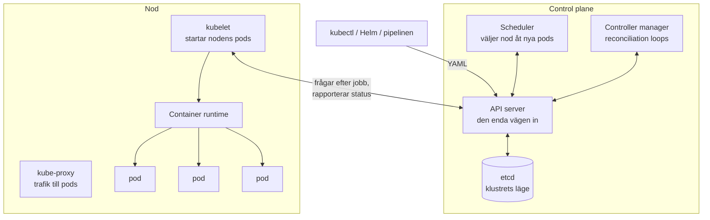

# clo25-kubernetes

Inlämningar för kursen Cloud Developer Kubernetes.

## Innehåll

- `src/` – appen och dess Dockerfile
- `k8s/` – Kubernetes-manifest (Deployment, Service, ConfigMap, Ingress)
- `charts/beacon/` – Helm chart för hela lösningen
- `docs/` – exempel på appens Secret, utan riktiga värden
- `.github/workflows/` – bygger imagen, pushar den till ghcr.io och rullar ut den på AKS
- `infra/` – Bicep för AKS-klustret och budgetvarningen

## Arkitekturen

Ett Kubernetes-kluster består av två sorters maskiner: **control plane**, som bestämmer vad som ska köras var, och **noder**, som kör containrarna. I mitt lokala kluster (k3d) är en enda container både control plane och nod. På AKS sköter Azure control plane och jag har en nod.



- **API servern** är den enda vägen in i klustret. Allt går genom den: kubectl, schedulern, controllers och kubelet. Den kontrollerar det jag skickar och sparar det i **etcd**, databasen med klustrets läge.
- **Schedulern** tittar på nya pods som ännu inte har en nod och väljer en nod med tillräckligt ledigt minne och CPU, utifrån podens `requests`.
- **Controller manager** kör reconciliation-looparna: den jämför hela tiden det önskade läget (t.ex. `replicas: 3`) med det som faktiskt körs, och agerar när de skiljer sig.
- **kubelet** finns på varje nod. Den frågar API servern vilka pods som ska köras på noden, ber container runtime starta dem, och rapporterar tillbaka hur det går. Den kör också readiness- och liveness-proberna.

**Från `kubectl apply` till en pod som körs:**

1. `kubectl apply` (eller `helm upgrade --install`) skickar YAML till API servern.
2. API servern kontrollerar den och sparar den i etcd.
3. Deployment-controllern ser en ny Deployment och skapar ett ReplicaSet, som skapar poddarna. De har ingen nod än.
4. Schedulern väljer en nod för varje pod.
5. kubelet på noden ser att den har fått en pod, hämtar imagen från ghcr.io och startar containern.
6. kubelet rapporterar `Running` tillbaka. När readiness-proben svarar räknas poden som redo och får trafik.

Inget av stegen är "kubectl startar containern". Jag beskriver bara vad jag vill ha, och klustret ser till att det blir så.

## Hur trafiken kommer in

En **Service** ger poddarna ett stabilt namn och en adress, och delar trafiken mellan dem. Men min Service är av typen `ClusterIP`, så den nås bara inifrån klustret. För att nå appen utifrån behövs en **Ingress**: en regel som säger att förfrågningar ska gå till Servicen `beacon` på port 80.

En Ingress gör ingenting själv. Den läses av en **ingress controller**, och i min lösning är det **Traefik**. Lokalt följer Traefik med k3s. På AKS installerar jag Traefik med Helm, och dess Service av typen `LoadBalancer` får en publik IP-adress från Azure. Fördelen är att en enda controller, med en enda publik adress, kan ta in trafik för alla appar i klustret, i stället för en betald publik adress per app.

Vägen in: webbläsare → publik IP (AKS) eller `localhost:8080` (k3d) → Traefik → Ingress-regeln → Service `beacon` → en av tre pods.

## How to run it

0. Only on a cluster without an ingress controller, such as AKS (k3d already has Traefik):

   ```bash
   helm repo add traefik https://traefik.github.io/charts
   helm repo update traefik
   helm install traefik traefik/traefik \
     --namespace traefik \
     --create-namespace \
     --version 41.6.1
   ```

1. Create the pull secret, with a GitHub token that has only `read:packages`. The first line waits for you to
   paste the token:

   ```bash
   printf 'GitHub token: ' && read -rs GHCR_TOKEN && echo

   kubectl create secret docker-registry ghcr-secret \
     --docker-server=ghcr.io \
     --docker-username=95hanmel-coder \
     --docker-password=$GHCR_TOKEN
   ```

2. Create the app's secret:

   ```bash
   kubectl create secret generic beacon-secret \
     --from-literal=BEACON_API_KEY='your-key'
   ```

3. Install the chart:

   ```bash
   helm upgrade --install beacon ./charts/beacon
   ```

A green run of the pipeline: [Release version 5](https://github.com/95hanmel-coder/clo25-kubernetes/actions/runs/40201463833)
